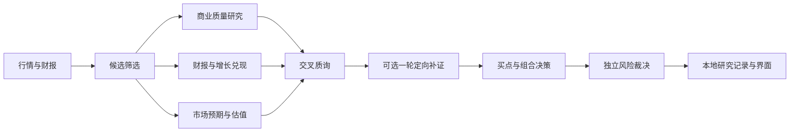

# 架构与实现范围

## 价值模块数据流

| 职责 | 文件 |
| --- | --- |
| CLI、初始化、服务入口 | `cli.py`、`__main__.py` |
| 本机配置 | `config.py` |
| 模块定义与本地持久化 | `module_service.py` |
| 独立模块数据采集 | `module_data.py` |
| 价值、尾盘、ETF 筛选规则 | `value_strategy.py`、`closing_strategy.py`、`etf_strategy.py` |
| 专业角色任务与结构化合同 | `module_agents.py` |
| 讨论、补证、组合与风控流程 | `module_pipeline.py` |
| Codex 调用、登录检查、失败记录 | `runner.py` |
| 页面及 HTTP 路由 | `module_dashboard.py`、`dashboard.py` |
| 历史数据与财报存储 | `market_store.py`、`history.py`、`fundamentals.py` |
| 原缠论工作流 | `pipeline.py`、`registry.py`、`chanlun.py` |

表中 Python 文件均位于 `src/ai_quant/`。
旧版流程注册 14 个 Agent 职责，与三个独立模块的六角色流程分别维护，不能将数量相加当成单次同时参与人数。

## 事实、判断与执行

来源、报告期、报价时间和研究时间分别记录。现金与持仓以人工确认的账本事实为准。
结构化方案和本地影子成交不会改写券商账户，也不会因为存在研究草案就视为已批准交易。
数据不完整或行情过期时，界面保留研究状态与限制。

现有估值输出按每股指标与倍数表达，保留三情景、介入条件、失效条件和证据缺口。
课堂股利折现案例不属于当前生产合同，不能将案例结果当成本程序运行所得。

## 后续方向

- 总控统一调度八角色，统筹大盘、行业、商业、财务估值、公告、反方与风控意见。
- 将买入、等待与卖出信号统一到可追溯的决策合同。
- 把股利折现及参数敏感性纳入正式估值合同与验证。
- 用户可配置的周期复核与事件触发复核。

这些条目是规划，并非本发布版已具备的完整能力。
